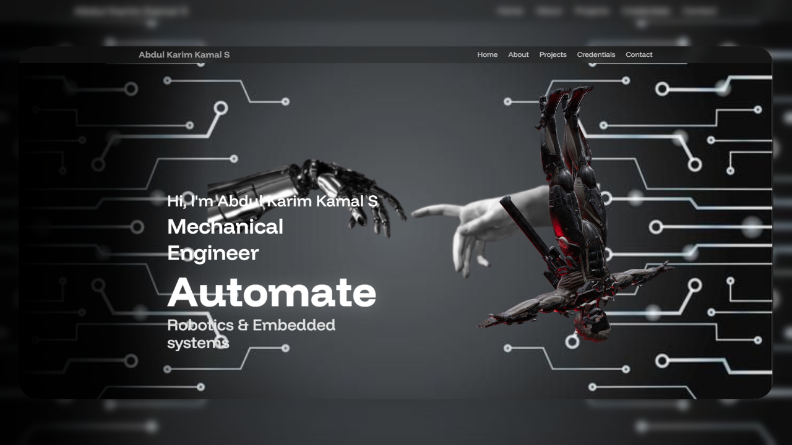

# 🚀 3D Engineering & Developer Portfolio | Abdul Karim Kamal S
Check out my [3D Interactive Portfolio](https://abdulkk-mech.vercel.app/)
[](https://abdulkk-mech.vercel.app/)
[](https://react.dev/)
[](https://threejs.org/)
[](https://tailwindcss.com/)

A modern, animated 3D developer portfolio built with React, Three.js, TailwindCSS, and motion effects. This project creatively showcases my expertise spanning mechanical design (Solid Edge, CAD), robotics, embedded systems (ESP32, IoT), and AI integrations.



---

## 📚 Table of Contents

- [Features](#-features)
- [Tech Stack](#-tech-stack)
- [Project Structure](#-project-structure)
- [Getting Started](#-getting-started)
- [Contact Me](#-contact-me)

---

## ✨ Features

- 🔥 **Interactive 3D Visuals:** Powered by React Three Fiber, Drei, and embedded Sketchfab viewers to showcase intricate engineering models.
- ⚡ **Fluid Animations:** Smooth transitions and scroll-based animations orchestrated by Framer Motion.
- 🎨 **Responsive UI:** Clean, mobile-first design implemented with TailwindCSS.
- 💌 **Live Contact Form:** Fully functional messaging system integrated directly with EmailJS.
- 🧱 **Modern Components:** Beautiful UI enhancements utilizing Aceternity UI and Magic UI.
- 🚀 **Optimized Performance:** Lightning-fast development and build environment powered by Vite.

---

## 🛠 Tech Stack

| Technology | Description |
|---|---|
| **React** | Front-end JavaScript library |
| **Vite** | Fast bundler and dev environment |
| **TailwindCSS** | Utility-first CSS framework |
| **React Three Fiber** | 3D rendering with Three.js in React |
| **Drei** | Helpers and abstractions for R3F |
| **Framer Motion** | Animation library for React |
| **EmailJS** | Form handling and email integration |
| **Aceternity UI** | Custom interactive UI components |

---

## 📁 Project Structure

```bash
├── public/
│   ├── assets/             # Images, certificates, resumes, logos
│   ├── models/             # 3D models (e.g., glTF/glb files)
│   └── vite.svg
├── src/
│   ├── components/         # Reusable UI components
│   ├── constants/          # Site data (certifications, projects, etc.)
│   ├── sections/           # Portfolio sections (Hero, Credentials, Contact)
│   ├── App.jsx             # Main app component
│   ├── index.css           # Tailwind CSS styles
│   └── main.jsx            # Entry point
├── tailwind.config.js      # Tailwind configuration
└── vite.config.js          # Vite configuration
